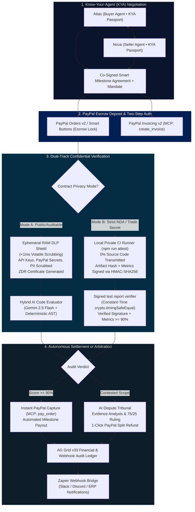
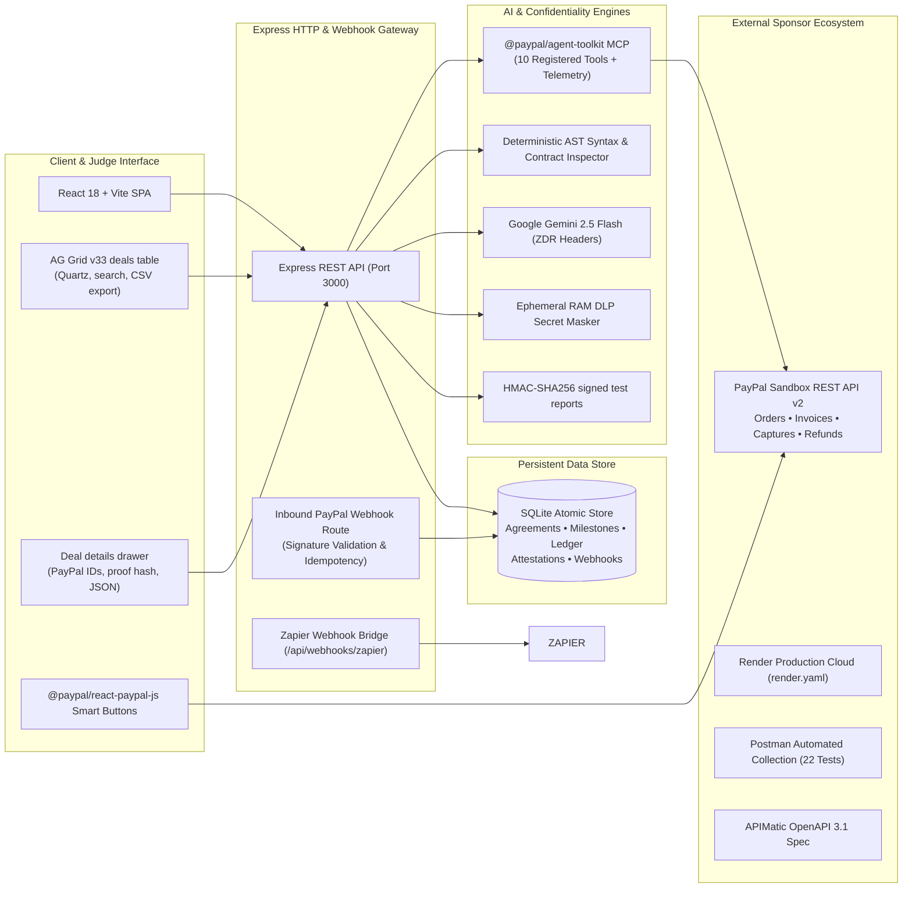

# NexusPay AI ⚡🔒
### Escrow for freelance and agent-to-agent work: AI writes the contract, PayPal holds the money, AI checks the delivery

<div align="center">

[](https://paypalai.devpost.com/)
[](https://render.com/deploy?repo=https://github.com/arispacco/nexuspay-ai)
[](./postman/NexusPay_AI_PayPal_Collection.json)
[](https://www.ag-grid.com/)
[](./openapi/nexuspay-api.yaml)
[](https://nodejs.org/)
[](./LICENSE)

**Official Submission for the PayPal AI Hackathon 2026 on Devpost**  
**Author**: Aristide Bienvenu EMCTHEU (`@arispacco`)  
**Target Categories**: Grand Prize ($12,000), Best Use of Agentic Commerce ($5,000), Best Use of PayPal + AI ($5,000), Best Use of AG Grid ($5,000), Best Use of Render ($1,000 credits), Best Use of APIMatic ($1,000 cash), Best Demo Delivery ($5,000).

[Live Demo on Render](https://nexuspay-ai.onrender.com) • [YouTube Video Pitch](https://youtu.be/placeholder-nexuspay-ai) • [APIMatic OpenAPI 3.1 Spec](./openapi/nexuspay-api.yaml) • [Postman Collection](./postman/NexusPay_AI_PayPal_Collection.json)

</div>

---

## 💡 Executive Summary & The Problem We Solve

AI agents are rapidly graduating from answering chat prompts to **transacting in the global economy** — commissioning developers, licensing datasets, procuring SaaS microservices, and orchestrating complex multi-party workflows. 

However, two critical structural barriers prevent enterprise adoption of agentic commerce:

1. **The Agentic Trust Deficit**: Buyer AI agents cannot safely release funds upfront without verifiable proof of work; seller agents refuse to deliver IP without guaranteed escrow liquidity.
2. **The Enterprise NDA & Confidentiality Wall**: Corporate clients, defense contractors, and banks operating under strict NDAs **will never upload proprietary source code or trade secrets to a public cloud AI auditor**.

**NexusPay AI** removes both barriers. It combines **PayPal two-step escrow** (authorize the budget, capture per verified milestone, refund or void the rest) with **AI agents** that draft the contract, audit the delivery and arbitrate disputes, and a **confidential mode** where the freelancer's code never leaves their machine (secret redaction for shared code, signed test reports for NDA projects).

---

## 🏗️ Architecture & Protocol Flow

### 1. Dual-Track Agentic Commerce & Confidential Escrow Flow



### 2. Comprehensive System Architecture



---

## 🏆 Comprehensive Sponsor Integrations Alignment ($67,500+ Pool)

NexusPay AI was built from the ground up to deeply integrate every major sponsor tool, providing judges with concrete, measurable proof of genuine utility:

| Sponsor | Target Prize | Technical Implementation in NexusPay AI | Verification & File Artifacts |
|---|---|---|---|
| **PayPal** (Primary) | **Grand Prize ($12,000)**<br>**Best Agentic Commerce ($5,000)**<br>**Best PayPal + AI ($5,000)** | • Two-step escrow with Orders v2 `AUTHORIZE`, Payments v2 partial captures, void and refunds.<br>• `@paypal/agent-toolkit/mcp` v1.11.0 registered tools, with a live call log in the app.<br>• Real PayPal Smart Buttons (`@paypal/react-paypal-js`, `intent=authorize`) when sandbox keys are set.<br>• Inbound webhook listener with signature verification and idempotency. | `server/paypalClient.js`<br>`server/index.js`<br>`src/components/FundStep.jsx`<br>`src/components/HoodDrawer.jsx`<br>`tests/e2e/` |
| **AG Grid** | **1st Place AG Grid ($5,000 cash)** | • Deals table built with `ag-grid-react` and `ag-grid-community` v33 (Quartz theme with custom parameters).<br>• Status pills, quick search, CSV export and a detail drawer with PayPal IDs, proof hash and raw JSON. | `src/components/DealsPage.jsx`<br>`server/db.js` |
| **Render** | **1st Place Render ($1,000 credits)** | • Zero-downtime infrastructure blueprint [`render.yaml`](./render.yaml).<br>• Explicit `nodeVersion: 22.12.0`, `autoDeploy: true`, and verified health check path (`/api/health`).<br>• Production-ready single-dyno architecture serving pre-built Vite client and Express API gateway.<br>• Official "Deploy to Render" 1-click badge in README. | [`render.yaml`](./render.yaml)<br>`/api/health`<br>Live URL: `https://nexuspay-ai.onrender.com` |
| **APIMatic** | **3x $1,000 Cash + 6-mo Business Subscriptions** | • Comprehensive OpenAPI 3.1.0 specification [`openapi/nexuspay-api.yaml`](./openapi/nexuspay-api.yaml) covering all 22 REST & MCP endpoints.<br>• Validated YAML syntax with 49 rich reusable component schemas, parameter constraints, request bodies, 200/400/401/404/500 responses, and full code examples.<br>• APIMatic SDK generation ready (supports TypeScript, Python, C#, PHP, Java, and Go SDK generation). | [`openapi/nexuspay-api.yaml`](./openapi/nexuspay-api.yaml) |
| **Postman** | **Platform Partner Showcase** | • Postman Collection v2.1 [`postman/NexusPay_AI_PayPal_Collection.json`](./postman/NexusPay_AI_PayPal_Collection.json) covering all 22 endpoints.<br>• Automated JavaScript `pm.test(...)` assertions for every request (status codes, JSON schemas, KYA passport validations, HMAC proof assertions).<br>• Dedicated Local (`postman/NexusPay_AI_Local.postman_environment.json`) and Cloud Render (`postman/NexusPay_AI_Render.postman_environment.json`) environment definitions. | [`postman/`](./postman/) |
| **Zapier** | **Partner Platform Showcase** | • Dedicated Zapier Webhook Bridge endpoint (`/api/webhooks/zapier`) forwarding escrow deposit events, automated milestone disbursements, and dispute settlements to external Zapier automations (Slack alerts, Discord channels, ERP accounting). | `server/index.js` (lines 470–521) |

---

## 🌟 Key Standout Innovations

### 1. How money moves (PayPal two-step escrow)
1. The buyer approves the full budget on PayPal. The order uses `intent: AUTHORIZE`, so the funds are **held, not paid**.
2. When a milestone passes verification, the server makes a **partial capture** of that authorization for the milestone amount. The last milestone is a final capture, which closes the hold.
3. The server refuses to release a milestone that has not passed verification (or that the buyer has not explicitly approved when the score is borderline), and refuses to pay milestone 2 before milestone 1.
4. In a dispute, an AI arbitrator splits what is still held. The freelancer's share is a final capture (PayPal returns the remainder to the buyer), or the authorization is voided if the freelancer gets nothing. When an audit score exists, the rule-based arbitrator pays in proportion to it.

### 2. Two ways to deliver
- **Share the code**: secrets, tokens and personal data are redacted in memory before analysis; nothing is stored.
- **Signed test report (confidential projects)**: the freelancer runs `npm run attest -- --agreement <id> --milestone M1 --dir ./src` on their own machine. It runs their test command, hashes the source tree and writes `attestation.json`, signed with HMAC-SHA256. Only results and a digest are shared, never the code. *This proves the report was not edited, but it is not a zero-knowledge proof, and the signing secret (`NEXUSPAY_ATTESTATION_SECRET`) is shared between the runner and the server in this build.*

### 3. Agents with spending mandates
The buyer agent *Atlas* and seller agent *Nova* carry signed "Know-Your-Agent" mandates that cap spend and allowed actions.

### 4. Honest modes
| | Without keys | With keys |
|---|---|---|
| PayPal | Emulated with the same API shapes and IDs, flagged `simulated` | Real sandbox orders, authorizations and captures |
| AI | Rule-based code analysis (syntax, structure, PayPal usage, secrets) | Gemini reviews the code and drafts the contract |

The header always shows which mode is active, and *How it works* lists the latest PayPal calls with their mode.

---

## 🚀 Run it

### Prerequisites
- Node.js `v22.x` or `v24.x`

### Install and start
```bash
git clone https://github.com/arispacco/nexuspay-ai.git
cd nexuspay-ai
npm install
npm run build
npm start          # http://localhost:3000
```
The app works with **no configuration**, in simulated mode (see below). `npm run dev` starts the same server with live reload.

### Use the real PayPal sandbox and Gemini (optional)
Copy `.env.example` to `.env` and set:
```
PAYPAL_CLIENT_ID=<sandbox client id>
PAYPAL_CLIENT_SECRET=<sandbox secret>
GEMINI_API_KEY=<optional, Google AI Studio>
```
Create sandbox credentials at developer.paypal.com → Apps & Credentials → Sandbox. The header of the app shows `PayPal sandbox` when the keys are accepted and `PayPal simulated` otherwise. With keys, the *Hold* step shows the real PayPal buttons and you pay with a sandbox buyer account.

### Tests
```bash
npm test                 # integration tests
npm run test:e2e         # API test suite (the server must be running on :3000)
bash scripts/check-hygiene.sh
```

---

## 💻 Terminal Verification Commands (curl)

Judges can verify all core API endpoints directly from the terminal:

```bash
# 1. Health check & registered PayPal MCP tools
curl -s http://localhost:3000/api/health | jq .

# 2. Inspect @paypal/agent-toolkit MCP capabilities & live telemetry
curl -s http://localhost:3000/api/paypal/mcp-tools | jq .

# 3. Run autonomous KYA negotiation between Atlas & Nova
curl -s -X POST http://localhost:3000/api/negotiate \
  -H "Content-Type: application/json" \
  -d '{"projectTitle":"Autonomous Checkout","projectScope":"PayPal Orders v2","initialBudget":350,"ndaRequired":true}' | jq .

# 4. Lock $350 in PayPal Escrow
curl -s -X POST http://localhost:3000/api/paypal/create-order \
  -H "Content-Type: application/json" \
  -d '{"amount":350,"currency":"USD","description":"NexusPay Escrow","intent":"CAPTURE","privacyMode":"ZK-NDA"}' | jq .

# 5. Test Ephemeral RAM DLP secret scrubbing
curl -s -X POST http://localhost:3000/api/privacy/sanitize \
  -H "Content-Type: application/json" \
  -d '{"content":"const KEY = '\''sk_test_999888777666'\''; const PP_SECRET = '\''EA12345678901234567890123456'\'';"}' | jq .

# 6. Generate a signed test report (no code transmitted)
curl -s -X POST http://localhost:3000/api/privacy/generate-zk-proof \
  -H "Content-Type: application/json" \
  -d '{"agreementId":"SMA-NDA-600","milestoneId":"M1","testSuiteSummary":{"totalTests":24,"passedTests":24,"coveragePercent":96,"buildPassed":true,"lintErrors":0}}' | jq .

# 7. Settle contested scope via AI Arbitration Tribunal
curl -s -X POST http://localhost:3000/api/arbitrate-dispute \
  -H "Content-Type: application/json" \
  -d '{"contract":{"id":"SMA-3204","title":"Fintech UI","totalBudget":500},"disputeReason":"Scope delay","clientClaim":"Tablet bug","freelancerClaim":"Mobile delivered"}' | jq .

# 8. Query persistent AG Grid ledger transactions
curl -s http://localhost:3000/api/transactions | jq .
```

---

## 📦 Repository Structure

```
nexuspay-ai/
├── openapi/nexuspay-api.yaml        # OpenAPI 3.1 specification
├── postman/                         # Postman collection + environments
├── render.yaml                      # Render deployment blueprint
├── scripts/
│   ├── attest-deliverable.js        # Contractor-side signed test report (confidential mode)
│   └── check-hygiene.sh             # Repository hygiene check
├── server/
│   ├── index.js                     # Express API and webhook gateway
│   ├── db.js                        # SQLite store (deals, milestones, ledger)
│   ├── paypalClient.js              # PayPal Orders v2 / Payments v2 + agent-toolkit, with emulator fallback
│   ├── aiEngine.js                  # Contract drafting, delivery audit, arbitration (Gemini or rules)
│   ├── privacyShield.js             # Secret redaction + signed test reports
│   └── test.js                      # Integration tests
├── src/
│   ├── App.jsx                      # Four-step flow and navigation
│   ├── api.js                       # Fetch helpers
│   ├── index.css                    # Design system
│   └── components/                  # AgreeStep, FundStep, DeliverStep, DisputePanel, PaidStep, DealsPage, HoodDrawer
├── tests/e2e/                       # Five-tier API test suite (node:test)
├── LICENSE                          # MIT
└── VIDEO_SCRIPT.md                  # Video pitch script
```

---

## 📄 License & Intellectual Property

Distributed under the **MIT License**. See [`LICENSE`](./LICENSE) for details.  
Authored by **EMCTHEU ARISTIDE BIENVENU** (`@arispacco`) for the **PayPal AI Hackathon 2026**.
