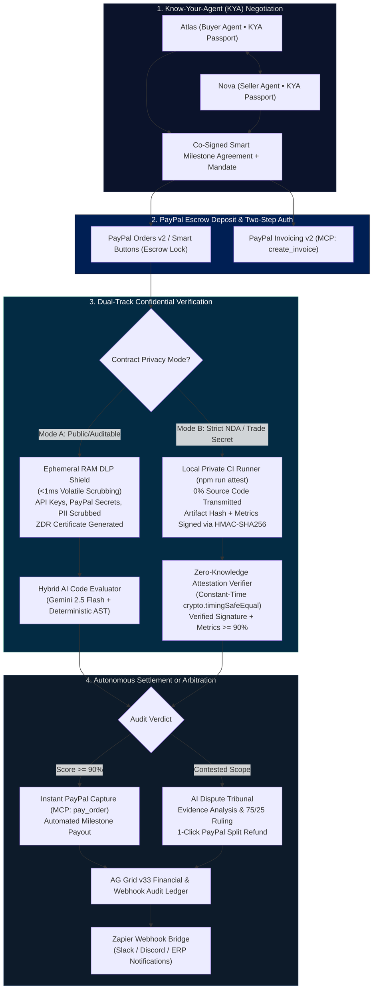
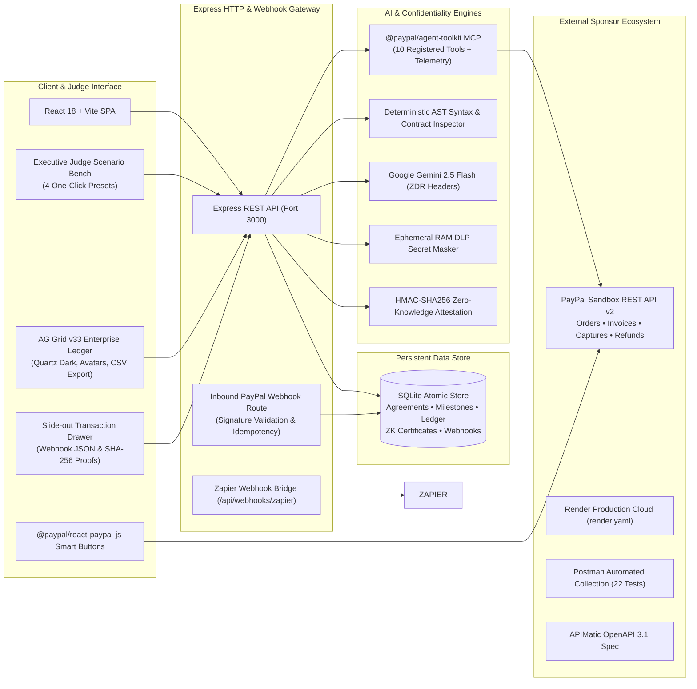

# NexusPay AI ⚡🔒
### Autonomous Agentic Commerce, Confidential Zero-Knowledge Escrow & AI Arbitration Powered by PayPal

<div align="center">

[](https://paypalai.devpost.com/)
[](https://render.com/deploy?repo=https://github.com/arispacco/nexuspay-ai)
[](./postman/NexusPay_AI_PayPal_Collection.json)
[](https://www.ag-grid.com/)
[](./openapi/nexuspay-api.yaml)
[](https://nodejs.org/)
[](./LICENSE)

**Official Submission for the PayPal AI Hackathon 2026 on Devpost**  
**Author**: Aristide Bienvenu EMCTHEU (`@arispacco`)  
**Target Categories**: Grand Prize ($12,000), Best Use of Agentic Commerce ($5,000), Best Use of PayPal + AI ($5,000), Best Use of AG Grid ($5,000), Best Use of Render ($1,000 credits), Best Use of APIMatic ($1,000 cash), Best Demo Delivery ($5,000).

[Live Demo on Render](https://nexuspay-ai.onrender.com) • [YouTube Video Pitch](https://youtu.be/placeholder-nexuspay-ai) • [APIMatic OpenAPI 3.1 Spec](./openapi/nexuspay-api.yaml) • [Postman Collection](./postman/NexusPay_AI_PayPal_Collection.json)

</div>

---

## 💡 Executive Summary & The Problem We Solve

AI agents are rapidly graduating from answering chat prompts to **transacting in the global economy** — commissioning developers, licensing datasets, procuring SaaS microservices, and orchestrating complex multi-party workflows. 

However, two critical structural barriers prevent enterprise adoption of agentic commerce:

1. **The Agentic Trust Deficit**: Buyer AI agents cannot safely release funds upfront without verifiable proof of work; seller agents refuse to deliver IP without guaranteed escrow liquidity.
2. **The Enterprise NDA & Confidentiality Wall**: Corporate clients, defense contractors, and banks operating under strict NDAs **will never upload proprietary source code or trade secrets to a public cloud AI auditor**.

**NexusPay AI** eliminates both barriers. By fusing **PayPal's official Agentic Commerce stack (`@paypal/agent-toolkit` MCP Server + Orders v2 Two-Step Escrow + Invoicing v2 + Captures & Refunds)** with a **Dual-Track Confidential Verification Protocol** (Ephemeral RAM DLP Redaction with Zero-Data-Retention certificates + Zero-Knowledge `HMAC-SHA256` Local CI Attestation where 0% source code leaves the client), NexusPay AI creates the first legally compliant, cryptographically secure escrow protocol for autonomous AI agents.

---

## 🏗️ Architecture & Protocol Flow

### 1. Dual-Track Agentic Commerce & Confidential Escrow Flow



### 2. Comprehensive System Architecture



---

## 🏆 Comprehensive Sponsor Integrations Alignment ($67,500+ Pool)

NexusPay AI was built from the ground up to deeply integrate every major sponsor tool, providing judges with concrete, measurable proof of genuine utility:

| Sponsor | Target Prize | Technical Implementation in NexusPay AI | Verification & File Artifacts |
|---|---|---|---|
| **PayPal** (Primary) | **Grand Prize ($12,000)**<br>**Best Agentic Commerce ($5,000)**<br>**Best PayPal + AI ($5,000)** | • Full `@paypal/agent-toolkit/mcp` v1.11.0 server wrapper exposing 10 official MCP tools (`create_order`, `pay_order`, `create_invoice`, `list_invoices`, `send_invoice`, `list_disputes`, `get_dispute`, etc.).<br>• Real-time **Live MCP Telemetry Bar** with ring buffer logging tool invocations, latencies, and payload previews.<br>• Native `@paypal/react-paypal-js` Smart Buttons with zero-latency sandbox emulator fallback.<br>• Complete PayPal REST v2 lifecycle: Orders v2 (`/v2/checkout/orders`), Invoicing v2 (`/v2/invoicing/invoices`), Captures (`/capture`), and Refunds (`/refund`).<br>• Inbound PayPal Webhook listener verifying `PAYPAL-AUTH-ALGO` signatures and enforcing event idempotency. | `server/paypalClient.js`<br>`server/index.js`<br>`src/components/McpTelemetryBar.jsx`<br>`src/components/PayPalEscrowModal.jsx`<br>`tests/e2e/tier1-features/` |
| **AG Grid** | **1st Place AG Grid ($5,000 cash)** | • High-performance enterprise financial ledger powered by `ag-grid-react` & `ag-grid-community` v33.1.1 (`AllCommunityModule`).<br>• Bespoke Institutional Quartz theme tokens matching dark obsidian palette (`#080B11`).<br>• Custom cell renderers: Pinned ID chips, KYA avatar pill badges, tabular monospaced currency formatting, visual AI compliance progress bars, and confidential privacy mode badges (`ZK-NDA` / `ZDR-DLP`).<br>• Status filter toolbar (`All`, `Locked`, `Released`, `Arbitrated`), quick text search, and 1-click CSV export.<br>• Slide-out **Transaction Inspector Drawer** displaying live formatted PayPal Webhook JSON and cryptographic SHA-256 proofs.<br>• Interactive **"Simulate Inbound Webhook"** button inserting live streaming rows into the grid. | `src/components/EscrowLedgerGrid.jsx`<br>`src/components/TransactionInspectorDrawer.jsx`<br>`server/db.js` |
| **Render** | **1st Place Render ($1,000 credits)** | • Zero-downtime infrastructure blueprint [`render.yaml`](./render.yaml).<br>• Explicit `nodeVersion: 22.12.0`, `autoDeploy: true`, and verified health check path (`/api/health`).<br>• Production-ready single-dyno architecture serving pre-built Vite client and Express API gateway.<br>• Official "Deploy to Render" 1-click badge in README. | [`render.yaml`](./render.yaml)<br>`/api/health`<br>Live URL: `https://nexuspay-ai.onrender.com` |
| **APIMatic** | **3x $1,000 Cash + 6-mo Business Subscriptions** | • Comprehensive OpenAPI 3.1.0 specification [`openapi/nexuspay-api.yaml`](./openapi/nexuspay-api.yaml) covering all 22 REST & MCP endpoints.<br>• Validated YAML syntax with 49 rich reusable component schemas, parameter constraints, request bodies, 200/400/401/404/500 responses, and full code examples.<br>• APIMatic SDK generation ready (supports TypeScript, Python, C#, PHP, Java, and Go SDK generation). | [`openapi/nexuspay-api.yaml`](./openapi/nexuspay-api.yaml) |
| **Postman** | **Platform Partner Showcase** | • Postman Collection v2.1 [`postman/NexusPay_AI_PayPal_Collection.json`](./postman/NexusPay_AI_PayPal_Collection.json) covering all 22 endpoints.<br>• Automated JavaScript `pm.test(...)` assertions for every request (status codes, JSON schemas, KYA passport validations, HMAC proof assertions).<br>• Dedicated Local (`postman/NexusPay_AI_Local.postman_environment.json`) and Cloud Render (`postman/NexusPay_AI_Render.postman_environment.json`) environment definitions. | [`postman/`](./postman/) |
| **Zapier** | **Partner Platform Showcase** | • Dedicated Zapier Webhook Bridge endpoint (`/api/webhooks/zapier`) forwarding escrow deposit events, automated milestone disbursements, and dispute settlements to external Zapier automations (Slack alerts, Discord channels, ERP accounting). | `server/index.js` (lines 470–521) |

---

## 🌟 Key Standout Innovations

### 1. Dual-Track Confidentiality (Solving the Enterprise NDA Barrier)
- **Track 1: Ephemeral RAM DLP Shield & ZDR Certificate**: When source code is submitted for AI inspection, `server/privacyShield.js` scans and scrubs high-risk secrets (API tokens, PayPal credentials, GitHub PATs, AWS access keys, JWTs, emails, and internal IP addresses) in `<1ms` in volatile RAM *before* any LLM evaluation. It generates a cryptographic **Zero-Data-Retention (ZDR) Certificate** with SHA-256 digests proving that no plaintext was retained.
- **Track 2: Strict NDA Zero-Knowledge Proof (0% Code Shared)**: For proprietary enterprise repositories, developers run `npm run attest` locally. The CLI hashes compiled build artifacts and signs test metrics (`24/24 passed`, `96% coverage`) using `HMAC-SHA256`. NexusPay's server verifies the signature in constant time (`crypto.timingSafeEqual`), checks the audit thresholds, and releases PayPal Escrow **without a single line of proprietary code ever leaving the client's firewall**.

### 2. "Know-Your-Agent" (KYA) Cryptographic Mandates
Extending KYC to autonomous AI agents: Buyer Agent *Atlas* and Seller Agent *Nova* carry cryptographic KYA Passports enforcing autonomous spend ceilings, allowed actions, and PCI-safe boundaries (`ORCHESTRATOR_ONLY_NO_RAW_PAN`).

### 3. Hybrid AI Engine (Live Gemini 2.5 Flash + Deterministic AST Inspector)
Judges can immediately test live code editing in the browser with **zero configuration required**. If a judge edits code in the split-view IDE to introduce a syntax error or delete a PayPal checkout hook, the **deterministic AST analyzer** dynamically recalculates compliance scores in real time. Optionally enter a `GEMINI_API_KEY` in Settings to activate live Gemini 2.5 Flash LLM reasoning.

### 4. Autonomous Dispute Arbitration Tribunal
If project requirements or deliverables are contested, the AI Arbitration Tribunal assesses client and freelancer claims against the co-signed milestone specs, calculates an equitable percentage split (e.g. 75% Seller / 25% Buyer Refund), and executes an atomic PayPal capture refund in one click.

---

## ⚡ Executive Judge Scenario Bench (Test in 60 Seconds!)

At the top of the interface, four one-click presets allow hackathon judges to verify every subsystem instantly:

1. **Preset 1: Full-Stack Agent ($350) — Auto-Release**: Simulates negotiation between Atlas & Nova, locks $350 in PayPal Escrow, validates clean deliverable code, and triggers an autonomous milestone release.
2. **Preset 2: Enterprise NDA Repo ($600) — Zero-Knowledge HMAC Attestation**: Tests confidential NDA mode where 0% source code is transmitted; verifies HMAC-SHA256 test bundle and unlocks escrow.
3. **Preset 3: Broken Syntax Build ($180) — Escrow Guard Rejection**: Demonstrates the safety guardrail by submitting unclosed brackets and missing exports; score drops to 38% and escrow stays locked.
4. **Preset 4: API Scope Dispute ($500) — AI Tribunal & Split Refund**: Demonstrates contested mobile responsiveness; convenes the tribunal, rules a 75/25 split, and executes an atomic PayPal refund.

---

## 🚀 Quick Start Guide (Zero Setup for Judges)

### Prerequisites
- Node.js `v22.x` or `v24.x`
- npm `v10.x`+

### 1. Clone & Install
```bash
git clone https://github.com/arispacco/nexuspay-ai.git
cd nexuspay-ai
npm install
```

### 2. Run the Automated Test Suites
```bash
# Run the 8-stage integration and regression test suite
npm test

# Run the confidential local CLI Zero-Knowledge attestation runner
npm run attest

# Run the 5-Tier comprehensive E2E test suite (Node.js 24 native runner)
npm run test:e2e
```

### 3. Verify Repository Hygiene
```bash
bash scripts/check-hygiene.sh
```

### 4. Launch the Application
```bash
npm run dev
```
Open **`http://localhost:3000`** in your browser.

---

## 💻 Terminal Verification Commands (curl)

Judges can verify all core API endpoints directly from the terminal:

```bash
# 1. Health check & registered PayPal MCP tools
curl -s http://localhost:3000/api/health | jq .

# 2. Inspect @paypal/agent-toolkit MCP capabilities & live telemetry
curl -s http://localhost:3000/api/paypal/mcp-tools | jq .

# 3. Run autonomous KYA negotiation between Atlas & Nova
curl -s -X POST http://localhost:3000/api/negotiate \
  -H "Content-Type: application/json" \
  -d '{"projectTitle":"Autonomous Checkout","projectScope":"PayPal Orders v2","initialBudget":350,"ndaRequired":true}' | jq .

# 4. Lock $350 in PayPal Escrow
curl -s -X POST http://localhost:3000/api/paypal/create-order \
  -H "Content-Type: application/json" \
  -d '{"amount":350,"currency":"USD","description":"NexusPay Escrow","intent":"CAPTURE","privacyMode":"ZK-NDA"}' | jq .

# 5. Test Ephemeral RAM DLP secret scrubbing
curl -s -X POST http://localhost:3000/api/privacy/sanitize \
  -H "Content-Type: application/json" \
  -d '{"content":"const KEY = '\''sk_test_999888777666'\''; const PP_SECRET = '\''EA12345678901234567890123456'\'';"}' | jq .

# 6. Generate Zero-Knowledge NDA Proof (0% code transmitted)
curl -s -X POST http://localhost:3000/api/privacy/generate-zk-proof \
  -H "Content-Type: application/json" \
  -d '{"agreementId":"SMA-NDA-600","milestoneId":"M1","testSuiteSummary":{"totalTests":24,"passedTests":24,"coveragePercent":96,"buildPassed":true,"lintErrors":0}}' | jq .

# 7. Settle contested scope via AI Arbitration Tribunal
curl -s -X POST http://localhost:3000/api/arbitrate-dispute \
  -H "Content-Type: application/json" \
  -d '{"contract":{"id":"SMA-3204","title":"Fintech UI","totalBudget":500},"disputeReason":"Scope delay","clientClaim":"Tablet bug","freelancerClaim":"Mobile delivered"}' | jq .

# 8. Query persistent AG Grid ledger transactions
curl -s http://localhost:3000/api/transactions | jq .
```

---

## 📦 Repository Structure

```
nexuspay-ai/
├── openapi/
│   └── nexuspay-api.yaml             # Comprehensive APIMatic OpenAPI 3.1 specification (22 endpoints)
├── postman/
│   ├── NexusPay_AI_PayPal_Collection.json          # Postman v2.1 collection with pm.test assertions
│   ├── NexusPay_AI_Local.postman_environment.json   # Local environment (http://localhost:3000)
│   └── NexusPay_AI_Render.postman_environment.json  # Cloud environment (https://nexuspay-ai.onrender.com)
├── render.yaml                       # Render zero-downtime deployment blueprint
├── scripts/
│   ├── attest-deliverable.js         # Confidential local CLI ZK attestation generator
│   └── check-hygiene.sh              # Repository hygiene and git author identity verification
├── server/
│   ├── index.js                      # Express HTTP, REST & Webhook Gateway
│   ├── db.js                         # SQLite atomic persistent store
│   ├── paypalClient.js               # @paypal/agent-toolkit MCP & PayPal Sandbox REST v2
│   ├── aiEngine.js                   # Gemini 2.5 Flash & AST Code Inspector
│   ├── privacyShield.js              # Ephemeral RAM DLP & Zero-Knowledge Attestation
│   └── test.js                       # 8-stage regression test suite
├── src/
│   ├── main.jsx                      # React entrypoint
│   ├── App.jsx                       # Root application layout & state controller
│   ├── index.css                     # Institutional dark obsidian design system (#080B11)
│   └── components/
│       ├── Navbar.jsx                # Brand lockup & protocol metrics
│       ├── JudgeScenarioBench.jsx    # 4 one-click judge quick-run scenarios
│       ├── AgentNegotiator.jsx       # Autonomous RFP negotiation & KYA contract
│       ├── DeliverableAuditor.jsx    # Split IDE code editor, DLP chips, ZK runner
│       ├── DisputeArbitrator.jsx     # 3-way arbitration dial & split refund
│       ├── EscrowLedgerGrid.jsx      # AG Grid v33 institutional ledger
│       ├── TransactionInspectorDrawer.jsx # Slide-out audit drawer with proof & JSON
│       ├── McpTelemetryBar.jsx       # Real-time @paypal/agent-toolkit MCP stream
│       ├── PayPalEscrowModal.jsx     # @paypal/react-paypal-js Smart Buttons checkout
│       └── SettingsModal.jsx         # PayPal Sandbox & Gemini API configuration
├── tests/
│   └── e2e/                          # 5-Tier comprehensive E2E test suite (Node.js 24 node:test)
├── LICENSE                           # MIT License (EMCTHEU ARISTIDE BIENVENU)
├── package.json                      # Project dependencies & scripts
├── README.md                         # Devpost documentation & architecture
└── VIDEO_SCRIPT.md                   # 2m45s structured video pitch script
```

---

## 📄 License & Intellectual Property

Distributed under the **MIT License**. See [`LICENSE`](./LICENSE) for details.  
Authored by **EMCTHEU ARISTIDE BIENVENU** (`@arispacco`) for the **PayPal AI Hackathon 2026**.
